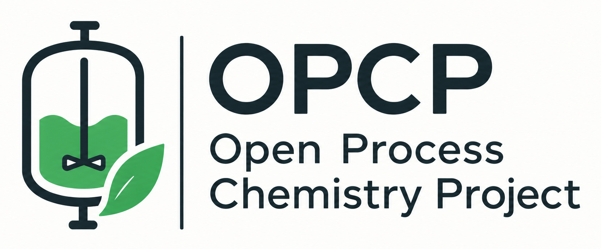
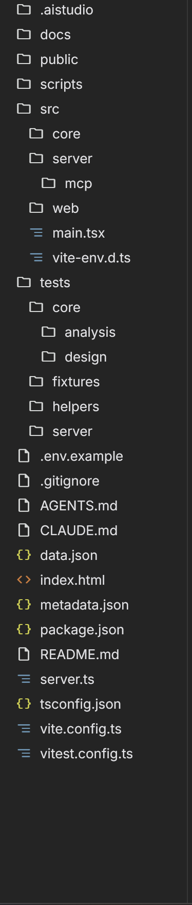

# OPCP — HPLC Solubility Calculator & Crystallization Process Engine

[](package.json)
[](package.json)
[](tsconfig.json)
[](src/index.css)

An enterprise scientific computing engine and laboratory workflow application developed for the **Open Process Chemistry Project (OPCP)**. Designed for analytical HPLC solubility determinations, multi-model thermodynamic fitting, Hansen Solubility Parameter (HSP) green solvent substitutions, and batch cooling crystallization process engineering.

<p align="center">
  
</p>



---

## 🌟 Six Core Scientific Modules

1. **Analytical HPLC Calibration**:
   - Multi-point linear calibration curves ($y = mx + b$ or forced through origin $y = mx$).
   - Automated $R^2$, slope, intercept, LOD, and LOQ diagnostics.
   - Comprehensive dilution factor accounting ($DF = V_{\text{total}} / V_{\text{aliquot}}$) with automatic reaction concentration recalculation.
   - PDF chromatogram report import parser for automatic sample data ingestion.

2. **Solubility Calculation & Multi-Sample Data Matrix**:
   - Multi-sample temperature and solvent composition tracking.
   - Replicate grouping, standard deviation, and coefficient of variation ($CV\%$) error metrics.
   - Support for pure solvents and binary mixture cosolvency measurements.

3. **Thermodynamic Prediction Models (2D & 3D Interactive WebGL Surface)**:
   - Fits experimental solid-liquid equilibrium data across temperature and binary solvent compositions:
     - **Modified Apelblat** (3-parameter semi-empirical)
     - **Clarke-Glew** thermodynamic expansion
     - **van 't Hoff** ideal solution
     - **Jouyban-Acree** (Full & Simplified) cosolvency
     - **Yalkowsky** log-linear cosolvency
     - **Combined Apelblat + Jouyban-Acree** simultaneous temperature-composition model
   - Interactive 2D slice curves and 3D WebGL response surface plots with real-time target prediction cursors.
   - High-contrast, theme-aware axis labeling and dark mode support.

4. **Lab Solvents Inventory**:
   - Built-in library of 40+ verified laboratory solvents with physical constants, boiling points, melting points, flash points, dielectric constants, and water miscibility.
   - Curated EHS hazard scores (1–10) and ICH Q3C Class 1, 2, and 3 classifications.
   - 3D Hansen Solubility Parameters ($\delta_D, \delta_P, \delta_H$).
   - One-click **"Save as Standard"** and **"Reset to Standard"** to preserve laboratory standard solvent lists.
   - Quick search, custom solvent additions, and automatic property enrichment.

5. **Green Chemistry & Solvent Replacement Engine**:
   - **3D Hansen Solubility Space**: Interactive Plotly 3D visualization showing target problem solvent coordinates, top drop-in candidates, and optimized binary blends.
   - **Single Drop-in Replacements**: Identifies safer alternatives to hazardous solvents (e.g., DCM, DMF, NMP) ranked by Hansen Euclidean distance ($R_a$), boiling point, and cost.
   - **Synergistic Binary Mixtures (Green Blends)**: Formulates two green solvents that combine to match the target solute's Hansen sphere closer than either pure component.
   - **EHS 3-Axis Hazard Radar**: Multi-pillar comparison (Occupational Health & Toxicology, Process Safety & Flammability, Environmental Fate & VOCs) aligned with Pfizer, GSK, and Sanofi green chemistry guides.

6. **Crystallization Planner & Batch Recipe SOP Generator**:
   - Solubility phase diagram with dynamic Metastable Zone Width (MSZW) boundaries.
   - Controlled cubic cooling trajectory (Mullin-Nývlt $T(t) = T_0 - (T_0 - T_f)(t/\tau)^3$) vs. linear uncontrolled cooling.
   - Critical seed loading mass ($C_s^*$), median seed particle size ($D_{50}$), specific surface area ($SSA$), and volumetric seed surface area ($A_V$).
   - Anti-solvent parabolic metering rates ($V_{AS}(t) = V_{\text{total}} \cdot (t/\tau)^2$).
   - Automated Batch Standard Operating Procedure (SOP) generator with printable execution checklists and CSV schedule export.

---

## 💾 Data Portability & Supported Exports

- **Excel Comprehensive Workbook (`.xlsx`)**: Multi-tab formatted spreadsheet containing calibration curves, sample calculations, thermodynamic regression parameters, solvent inventory, green replacement rankings, and crystallization schedules.
- **Interactive Standalone HTML Report (`.html`)**: Self-contained report with embedded interactive charts, complete dataset inspection, and dark/light styling.
- **Project State Backup (`.json`)**: Full laboratory project backup enabling seamless experiment transfer, archiving, and restoration.
- **Batch Crystallization Schedule (`.csv`)**: Time-stepped reactor setpoint tables ready for direct import into process automation controllers and SCADA systems.
- *(Note: Legacy PDF export was retired in favor of native Excel workbooks and self-contained Interactive HTML reports).*

---

## 📁 Repository Structure

```
├── docs/                      # Comprehensive scientific documentation suite
│   ├── ARCHITECTURE.md        # Architecture topology and component separation
│   ├── API_REFERENCE.md       # Exported functions, math engines, and types
│   ├── README.md              # Documentation navigation index
│   └── core/                  # In-depth scientific domain specifications
│       ├── CALIBRATION_ANALYSIS.md
│       ├── CRYSTALLIZATION.md
│       ├── DATA_MODELS.md
│       ├── GREEN_CHEMISTRY.md
│       └── SOLUBILITY_MODELS.md
├── public/                    # Static assets, branding, and templates
├── scripts/                   # Data migration, maintenance, and verification scripts
├── src/                       # Application source code
│   ├── assets/                # Application logos and icon assets
│   ├── components/            # React 19 UI tabs, charts, & Plotly 3D modals
│   │   └── crystallization/   # Phase diagrams, reactor schedules, and SOP modals
│   ├── data/                  # Solvent databases & Hansen parameters
│   ├── utils/                 # Thermodynamic engines, calibration math, & exports
│   ├── types.ts               # Global TypeScript definitions
│   ├── main.tsx               # Application bootstrap
│   └── index.css              # Global styles & Tailwind CSS dark mode utilities
├── tests/                     # Unit and integration test suite
│   ├── core/                  # Core scientific engine tests (analysis & design)
│   ├── fixtures/              # Reference dataset fixtures
│   └── helpers/               # Numerical validation helpers
├── AGENTS.md                  # Autonomous agent workflow rules & standards
├── CLAUDE.md                  # Developer guide & testing instructions
├── PULL_REQUEST.md            # Pull request specification & checklist
└── package.json               # Dependencies and scripts
```

---

## 🚀 Quick Start

### Prerequisites
- Node.js $\ge 18.0.0$
- npm $\ge 9.0.0$

### Installation & Development
```bash
# Install dependencies
npm install

# Start local development server (runs on port 3000)
npm run dev

# Run TypeScript type-checking
npm run lint

# Run unit and integration tests
npm test

# Build optimized production bundle
npm run build
```

---

## 📖 Scientific Documentation Index

Detailed thermodynamic derivations, mathematical models, and API references are available in **[`docs/`](./docs/README.md)**:
- [System Architecture Topology](./docs/ARCHITECTURE.md)
- [Thermodynamic Solubility Models (Apelblat, Jouyban-Acree, etc.)](./docs/core/SOLUBILITY_MODELS.md)
- [Crystallization Engineering (MSZW, Seeding, Cubic Cooling)](./docs/core/CRYSTALLIZATION.md)
- [Green Chemistry & Hansen Solubility Parameters](./docs/core/GREEN_CHEMISTRY.md)
- [HPLC Calibration & Dilution Diagnostics](./docs/core/CALIBRATION_ANALYSIS.md)
- [Data Models & TypeScript Schemas](./docs/core/DATA_MODELS.md)
- [API & Utility Derivations Reference](./docs/API_REFERENCE.md)

---

## 📄 Pull Request Documentation

For detailed release specifications, verification results, and scientific review criteria, refer to **[`PULL_REQUEST.md`](./PULL_REQUEST.md)**.
