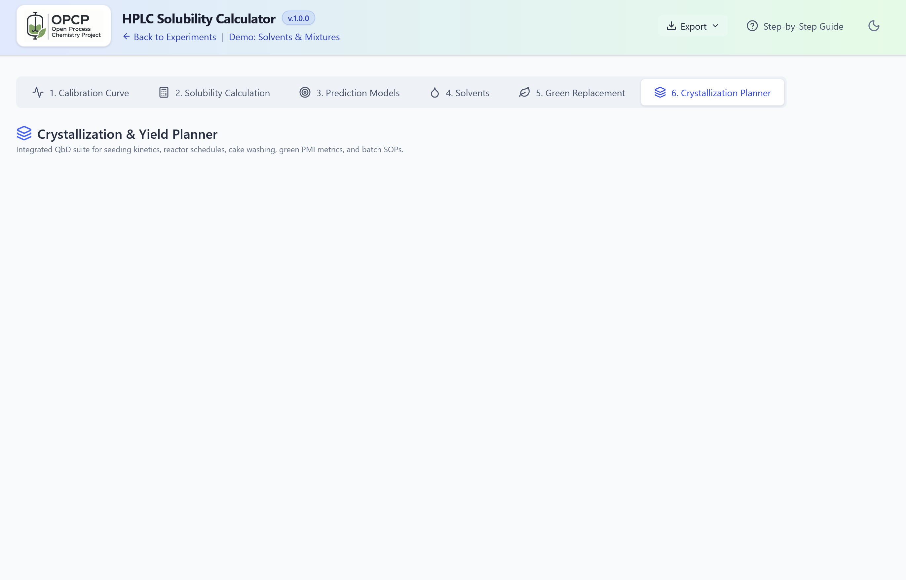

# OPCP — HPLC Solubility Calculator & Crystallization Process Engine

[](LICENSE)
[](package.json)
[](package.json)
[](tsconfig.json)
[](src/index.css)

An enterprise scientific computing engine and laboratory workflow application developed for the **Open Process Chemistry Project (OPCP)**. Designed for analytical HPLC solubility determinations, multi-model thermodynamic fitting, Hansen Solubility Parameter (HSP) green solvent substitutions, and batch cooling/anti-solvent crystallization process engineering.

<p align="center">
  
</p>

<p align="center">
  
</p>

---

## 🌟 Six Core Scientific Modules

1. **Analytical HPLC Calibration**:
   - Multi-point linear calibration curves ($y = mx + c$ or forced through origin $y = mx, c = 0$).
   - Automated $R^2$, slope ($m$), intercept ($c$), standard error, and residual analysis.
   - Comprehensive dilution factor accounting ($DF = V_{\text{total}} / V_{\text{aliquot}}$) with automatic reaction concentration recalculation from UV peak areas.
   - Live calibration point data table with instant validation and excluded-point toggles.

2. **Solubility Calculation & Multi-Sample Data Matrix**:
   - Multi-sample temperature, solvent selection, and binary solvent composition tracking.
   - Automatic replicate grouping, mean, standard deviation, and coefficient of variation ($CV\%$) error metrics.
   - Flexible support for pure solvents, binary mixture cosolvency measurements, and sample dilution factors.
   - Direct exclusion handling without loss of raw experimental history.

3. **Thermodynamic Prediction Models (2D Curves & 3D Interactive WebGL Surface)**:
   - Fits experimental solid-liquid equilibrium data across temperature and binary solvent compositions:
     - **Modified Apelblat** (3-parameter semi-empirical thermodynamic equation)
     - **Clarke-Glew** thermodynamic expansion
     - **van 't Hoff** ideal solution
     - **Jouyban-Acree** (Full & Simplified) cosolvency
     - **Yalkowsky** log-linear cosolvency
     - **Combined van 't Hoff / Apelblat + Yalkowsky** simultaneous temperature-composition models
     - **2D Quadratic Polynomial & Spline** mathematical models
   - Automatic thermodynamic model ranking and selection prioritizing physically grounded thermodynamic models over unconstrained polynomials when statistical indicators ($R^2$, Adjusted $R^2$, RMSE, AIC) are close.
   - Interactive 2D slice curves and 3D WebGL response surface plots with real-time target prediction cursors.
   - Full theme-aware high-contrast labeling supporting both light mode and dark mode.

4. **Lab Solvents Inventory**:
   - Built-in library of **55 curated laboratory standard solvents** matching official laboratory inventories.
   - Master reference database of **135+ solvents** with complete 3D Hansen Solubility Parameters ($\delta_D, \delta_P, \delta_H$).
   - Physical constants including boiling points, melting points, flash points, dielectric constants, viscosities, surface tensions, and water miscibility classifications.
   - Curated EHS hazard scores (1–10) and ICH Q3C Class 1, 2, and 3 classifications.
   - One-click **"Save as Standard"** and **"Reset to Standard"** to preserve laboratory custom inventories across sessions.
   - Real-time search, custom solvent additions, and automatic 16-parameter reference database enrichment.

5. **Green Chemistry & Solvent Replacement Engine**:
   - **3D Hansen Solubility Space**: Interactive Plotly 3D WebGL visualization showing target problem solvent coordinates, top drop-in candidates, and optimized binary blends.
   - **Theme-Aware Dark Mode**: Crisp high-contrast white axis titles and tick fonts, dark coordinate frame (`#1e293b`), floating dark legend, and camera view presets (Default 3D, Top $\delta_D$ vs $\delta_P$, Front $\delta_P$ vs $\delta_H$, Side $\delta_D$ vs $\delta_H$).
   - **Single Drop-in Replacements**: Identifies greener alternatives to hazardous solvents (e.g., DCM, DMF, NMP) ranked by Hansen Euclidean distance ($R_a$), toxicological profile, boiling point, and cost:
     $$R_a = \sqrt{4(\Delta\delta_D)^2 + (\Delta\delta_P)^2 + (\Delta\delta_H)^2}$$
   - **Synergistic Binary Mixtures (Green Blends)**: Formulates two green solvents that combine to match the target solute's Hansen sphere closer than either pure component.
   - **EHS 3-Axis Hazard Radar**: Multi-pillar comparison (Occupational Health & Toxicology, Process Safety & Flammability, Environmental Fate & VOCs) aligned with Pfizer, GSK, and Sanofi green chemistry guides.

6. **Crystallization Planner & Batch Recipe SOP Generator**:
   - **Three Operating Modes**: Temperature Cooling, Anti-Solvent Addition, and Simultaneous Cooling + Anti-Solvent Addition.
   - **Phase Diagram & Metastable Zone**: Dynamic Metastable Zone Width (MSZW) boundaries ($C_{\text{crit}} = C^* \cdot S_{\text{crit}}$) with live supersaturation tracking ($S(t)$ and driving force $\Delta C(t)$).
   - **Controlled Batch Trajectories**: Mullin-Nývlt cubic cooling trajectory:
     $$T(t) = T_0 - (T_0 - T_f)\left(\frac{t}{\tau}\right)^3$$
     and parabolic anti-solvent addition rates vs. uncontrolled linear operations.
   - **Seeding Kinetics & Physics**: Saturation point ($T_{\text{sat}}$), optimal seed point ($T_{\text{seed}}$), critical seed loading mass ($C_s^*$), median seed particle size ($D_{50}$), specific surface area ($SSA$), and volumetric seed surface area ($A_V$).
   - **Advanced Cake Washing & Filtration**: Plug-flow displacement washing vs. reslurry washing, interstitial mother liquor void volume holdup, cake porosity, wash liquor loss, wet cake to dry cake ratio, and filtration cycle times via Darcy-Ruth cake filtration theory.
   - **Green Process Metrics (ACS GCI)**: Comprehensive Process Mass Intensity (PMI) and Sheldon Environmental Factor ($E\text{-Factor}$) accounting for API, solvents, wash volumes, and product recovery.
   - **Automated Batch SOP Generator**: Generates comprehensive Standard Operating Procedure (SOP) documents with printable execution checklists and downloadable CSV reactor schedules.

---

## 💾 Data Portability & Supported Exports

- **Interactive Standalone HTML Report (`.html`)**: Self-contained offline report with embedded base64 OPCP logo, offline Tailwind/Plotly styling, interactive 2D curves, 3D response surface plot toggles, and searchable sample data tables.
- **Excel Comprehensive Workbook (`.xlsx`)**: Multi-tab formatted spreadsheet containing calibration curves, sample calculations, thermodynamic regression parameters, solvent inventory, green replacement rankings, and crystallization schedules with embedded Excel chart templates.
- **Project State Backup (`.json`)**: Full laboratory project backup enabling seamless experiment transfer, archiving, and restoration.
- **Batch Crystallization Schedule (`.csv`)**: Time-stepped reactor setpoint tables ready for direct import into process automation controllers, SCADA systems, and reactor recipes.
- **Solvents Inventory Backup (`.xlsx`, `.json`)**: One-click laboratory solvent inventory export and import.
- *(Note: Legacy PDF export was retired in favor of native Excel workbooks and self-contained interactive HTML reports).*

---

## 📁 Repository Structure

```
├── LICENSE                    # GNU Affero General Public License v3.0 (AGPL-3.0)
├── README.md                  # Root project overview and module documentation
├── package.json               # Dependencies, scripts, and build metadata
├── tsconfig.json              # TypeScript compilation rules
├── vite.config.ts             # Vite bundler configuration
├── vitest.config.ts           # Vitest configuration
├── index.html                 # HTML application entry point
├── metadata.json              # Application identity & permissions
├── .env.example               # Environment variable templates
├── .gitignore                 # Version control exclusions
├── docs/                      # Comprehensive scientific documentation suite
│   ├── ARCHITECTURE.md        # Architecture topology and component separation
│   ├── API_REFERENCE.md       # Exported functions, math engines, and types
│   ├── README.md              # Documentation navigation index
│   └── core/                  # In-depth scientific domain specifications
│       ├── CALIBRATION_ANALYSIS.md
│       ├── CRYSTALLIZATION.md
│       ├── DATA_MODELS.md
│       ├── GREEN_CHEMISTRY.md
│       └── SOLUBILITY_MODELS.md
├── public/                    # Static assets, branding, and templates
│   ├── Logo.png               # High-resolution OPCP brand logo
│   └── chart_template.xlsx    # Embedded Excel workbook template
├── src/                       # Application source code
│   ├── assets/                # Application logos and icon assets
│   ├── components/            # React 19 UI tabs, charts, & Plotly 3D modals
│   │   ├── CalibrationTab.tsx # HPLC calibration curve fitting
│   │   ├── SamplesTab.tsx     # Experimental sample matrix
│   │   ├── PredictionTab.tsx  # Thermodynamic 2D & 3D regression models
│   │   ├── SolventsTab.tsx    # 55-solvent curated laboratory inventory
│   │   ├── GreenReplacementTab.tsx # Green chemistry & solvent alternatives
│   │   ├── HansenSpaceModal.tsx    # 3D WebGL Hansen space visualization
│   │   ├── EhsRadarModal.tsx       # 3-pillar EHS hazard radar
│   │   └── crystallization/   # Phase diagrams, reactor schedules, and SOP modals
│   ├── data/                  # 55 default solvents & 135-solvent Hansen database
│   ├── utils/                 # Thermodynamic engines, calibration math, & exports
│   │   ├── calculations.ts    # HPLC dilution and triplicate calculations
│   │   ├── crystallization.ts # MSZW, seeding, cake washing, and PMI calculus
│   │   ├── greenChemistry.ts  # Hansen distance & binary mixture optimization
│   │   ├── htmlExport.ts      # Standalone interactive HTML report generator
│   │   ├── excelExport.ts     # Multi-tab styled Excel workbook export
│   │   └── models.ts          # Thermodynamic regression model algorithms
│   ├── types.ts               # Global TypeScript interface definitions
│   ├── utils.ts               # Linear regression and formatting helpers
│   ├── main.tsx               # React application entry point
│   └── index.css              # Global styles & Tailwind CSS dark mode utilities
├── tests/                     # Scientific validation test suite
│   ├── core/                  # Core calculation engine tests
│   ├── fixtures/              # Reference chemical dataset fixtures
│   └── helpers/               # Numerical tolerance assertion helpers
├── AGENTS.md                  # Autonomous agent workflow rules & standards
├── CLAUDE.md                  # Developer guide & testing instructions
└── PULL_REQUEST.md            # Pull request specification & checklist
```

---

## 🚀 Quick Start

### Prerequisites
- Node.js $\ge 18.0.0$
- npm $\ge 9.0.0$

### Installation & Development
```bash
# Install dependencies
npm install

# Start local development server (runs on port 3000)
npm run dev

# Run TypeScript static type-checking
npm run lint

# Build optimized production bundle
npm run build
```

---

## 📖 Scientific Documentation Index

Detailed thermodynamic derivations, mathematical models, and API references are available in **[`docs/`](./docs/README.md)**:
- [System Architecture Topology](./docs/ARCHITECTURE.md)
- [Thermodynamic Solubility Models (Apelblat, Jouyban-Acree, etc.)](./docs/core/SOLUBILITY_MODELS.md)
- [Crystallization Engineering (MSZW, Seeding, Cubic Cooling, Cake Wash)](./docs/core/CRYSTALLIZATION.md)
- [Green Chemistry & Hansen Solubility Parameters](./docs/core/GREEN_CHEMISTRY.md)
- [HPLC Calibration & Dilution Diagnostics](./docs/core/CALIBRATION_ANALYSIS.md)
- [Data Models & TypeScript Schemas](./docs/core/DATA_MODELS.md)
- [API & Utility Derivations Reference](./docs/API_REFERENCE.md)

---

## 📄 License

This program is free software: you can redistribute it and/or modify it under the terms of the **GNU Affero General Public License** as published by the Free Software Foundation, either version 3 of the License, or (at your option) any later version.

See the [LICENSE](LICENSE) file for the full license text.
